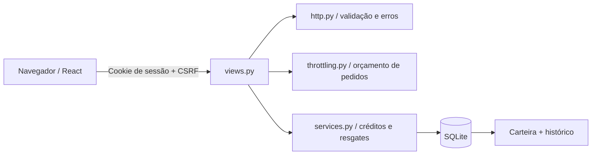
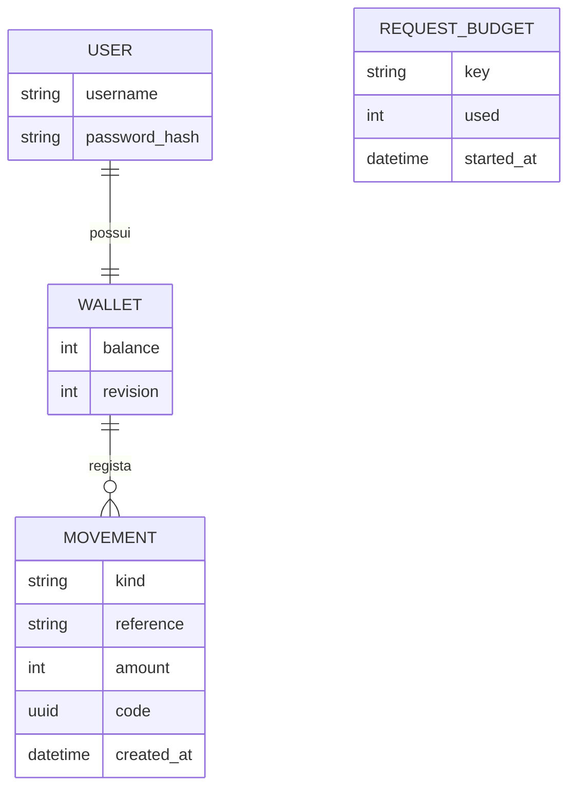

# Arquitetura e decisões

## Visão geral

Django serve a compilação React e a API na mesma origem. React gere formulários e apresentação, mas nunca decide o saldo. Os endpoints delegam as regras de pontos a `core/services.py`; o contrato HTTP e os limites de pedidos estão separados, para poderem ser testados sem duplicar lógica nos componentes.



A página inicial é `/`. A página autenticada é `/dashboard`; a secção pode ser ligada diretamente, por exemplo `/dashboard?view=history`. A navegação suporta voltar/avançar e atualizar a página. O atalho de teclado para o conteúdo usa uma âncora independente da seleção de secções.

`GET /api/session/` informa se existe sessão e fornece o cookie CSRF. O cliente apresenta entrada ou dashboard conforme a resposta. Uma visita direta ao dashboard sem sessão não recebe dados privados. Em desenvolvimento, o proxy do Vite encaminha `/api` para Django; não se ativa CORS.

## Dados e invariantes



- **User:** modelo de autenticação do Django; o registo não pede email. O username é normalizado com NFKC e distingue maiúsculas. As palavras-passe não são normalizadas nem cortadas.
- **Wallet:** uma carteira por conta, saldo inteiro não negativo e revisão incremental.
- **Movement:** crédito positivo ou resgate negativo, referência estável ao catálogo, descrição e montante no momento da operação. A combinação carteira/tipo/referência é única. O UUID do resgate só é devolvido ao seu titular.
- **RequestBudget:** contador persistente por âmbito/origem, com chave HMAC derivada do segredo da aplicação. Não guarda IP/nome em claro. Não constitui anonimização absoluta ou uma proteção contra todos os ataques distribuídos.

As operações expostas pela aplicação preservam:

```text
saldo >= 0
saldo = soma dos montantes do histórico
revisão = número de movimentos
cada desafio credita uma vez por conta
cada brinde pode ser resgatado uma vez por conta
```

A base impõe o sinal dos movimentos, a unicidade e o limite inferior do saldo. A igualdade entre saldo e histórico é preservada pelo serviço transacional e verificada nos testes; não existe um trigger que a imponha a alterações SQL feitas fora da aplicação. O histórico é um registo pessoal de operações, não um mecanismo criptográfico contra adulteração por administradores da base.

## Escritas e concorrência

O crédito usa uma atualização SQL `balance = balance + points` através de `F()`. O débito usa `balance >= cost` e `balance = balance - cost` na mesma instrução. Não existe uma janela entre ler o saldo em Python e gravar um valor calculado a partir dessa leitura.

Alteração da carteira, revisão e movimento correm em `transaction.atomic()`. A primeira escrita reserva o escritor SQLite antes das leituras que dependem da operação. Se a criação do movimento falhar por repetição, toda a transação é revertida. O tratamento de `IntegrityError` fica fora do bloco atómico, quando a ligação já pode voltar a ser usada.

Um resgate já efetuado devolve o conflito específico antes de tentar cobrar de novo. Saldo insuficiente é um conflito diferente. A fotografia de leitura também usa uma transação, para que saldo e movimentos pertençam ao mesmo estado da base.

Não se depende de `select_for_update()` para obter bloqueio por linha em SQLite. O orçamento de pedidos usa a mesma estratégia de escrita inicial: duas tentativas não conseguem consumir a última vaga em simultâneo. O orçamento é confirmado antes do hashing da palavra-passe.

SQLite serializa escritas e não é apresentado como solução para carga elevada. Um conflito temporário pode devolver 503 e `Retry-After`. Migrar para PostgreSQL exige voltar a rever e testar isolamento e bloqueios; não se afirma equivalência automática.

## Sessão e proteção HTTP

O Django gere hashing de palavras-passe e sessões em base de dados. O cookie de sessão é HttpOnly e SameSite=Lax. CSRF é validado nas mutações. O token CSRF pode ser lido pelo cliente; não é uma credencial de autenticação.

A API usa `Cache-Control: no-store`. A página usa CSP com scripts/estilos da própria origem, sem `unsafe-inline`/`unsafe-eval`, impede enquadramento por terceiros e desativa permissões de câmara, microfone e localização, que esta funcionalidade não utiliza.

Os limites de dez minutos incluem tentativas bem-sucedidas e falhadas: 5 logins por combinação IP/nome, 60 logins por IP e 10 registos por IP. Não se confia em `X-Forwarded-For`; por trás de um proxy, a política de origem precisa de uma configuração própria e de testes. O mecanismo não substitui limites globais no proxy e proteção contra ataques distribuídos.

`cleanup_expired` remove sessões expiradas e contadores com mais de um dia. Não remove contas, carteiras ou movimentos.

## Contrato da API

POST requer JSON, cookie CSRF e cabeçalho `X-CSRFToken`. Campos adicionais de saldo/preço/pontos nunca têm autoridade.

| Método e rota | Corpo | Resultado |
|---|---|---|
| GET `session/` | — | `{user: null}` ou fotografia da carteira |
| POST `register/` | `username`, `password`, `confirmation` | 201; conta e sessão iniciadas |
| POST `login/` | `username`, `password` | 200; sessão iniciada |
| POST `logout/` | `{}` | 200; saída idempotente |
| POST `claim/` | `id`, `answer` inteiro baseado em zero | 200; crédito e explicação |
| POST `redeem/` | `id` | 200; débito e código |

`claim/` e `redeem/` aceitam também `expected_user`: o cliente envia o nome que está a mostrar. O servidor compara-o com a conta da sessão e rejeita uma troca de conta entre separadores. Esse nome não autentica nem permite escolher a carteira.

A fotografia contém `user`, `balance`, `revision`, `earned`, `spent`, `challenges`, `rewards` e `movements`. As respostas dos desafios não são publicadas; a explicação só aparece depois da conclusão. Datas são ISO 8601; a apresentação usa a hora de Lisboa.

Os erros têm `error`, `code` e, quando aplicável, `fields` ou `retry_after`. Os campos têm listas de mensagens de texto. Estados principais: 400 validação, 401 autenticação, 403 CSRF, 404 item/rota, 405 método, 409 conflito, 413 dimensão, 415 formato, 429 limite e 503 indisponibilidade. Respostas inesperadas de infraestrutura continuam a ter um tratamento seguro no cliente.

## Recuperação no cliente

`api.js` limita o tempo de espera a 25 segundos. Só repete automaticamente uma mutação quando recebe o código explícito `csrf_failed`, que significa que o middleware a rejeitou antes da execução. Uma falha de rede não provoca repetição automática de um débito.

Após uma resposta perdida ou conflito, `usePassport` consulta a sessão para reconciliar o estado. Se encontrar a operação registada, confirma-a. Se não conseguir verificar o resultado, não afirma sucesso. A unicidade do servidor continua a proteger uma repetição manual.

Uma resposta antiga não substitui uma revisão mais recente da mesma carteira. Leituras iniciadas antes de uma mutação são invalidadas. Um bloqueio em `ref` impede dois pedidos iniciados no mesmo instante, antes de React atualizar o botão.

`BroadcastChannel` transporta apenas uma indicação de alteração, sem dados privados. Outros separadores voltam a consultar a API. A página também revalida ao recuperar foco, ligação ou visibilidade. Se o browser não tiver BroadcastChannel, continuam disponíveis a revalidação e o botão de atualização.

## Acessibilidade e experiência

Os campos têm labels e erros associados por `aria-describedby`/`aria-invalid`; o foco vai para o primeiro campo inválido. Os desafios usam fieldsets, legendas e radio buttons. A confirmação usa `dialog` nativo, cancelamento por Escape e devolução do foco. Durante o pedido, impede-se fechar como se o débito tivesse sido cancelado; um erro permanece visível dentro do modal.

Há foco visível, atalho para o conteúdo, controlos com dimensão adequada, respeito por redução de movimento e contraste verificado automaticamente nas vistas testadas. Evita-se interpolar texto e fundo dos filtros, pois a transição podia produzir contraste insuficiente.

A exportação CSV inclui só o histórico da conta e escapa aspas, separadores e descrições que poderiam ser interpretadas como fórmulas. Códigos são apresentados completos e podem ser copiados; a interface explica quando o clipboard não está disponível.

## Atualização e âmbito

As migrações preservam contas e movimentos da versão inicial. A migração de dados calcula a revisão das carteiras a partir do histórico existente. Existe um teste que migra uma base antiga, verifica o hash da palavra-passe e confirma saldo, histórico e código de resgate.

O catálogo fica em `core/catalog.py`, com identificadores estáveis. Os valores históricos ficam no movimento; alterar um preço futuro não reescreve operações passadas. Brindes são ilustrativos, sem stock ou entrega física. Os desafios permitem tentar respostas: não são uma prova de presença ou um mecanismo anti-fraude para concursos.

O arranque fornecido é local e liga apenas a 127.0.0.1. Uma instalação pública exige HTTPS, segredo aleatório com pelo menos 50 caracteres, hosts explícitos, servidor WSGI e assets próprios, além de operação e proteção contra abuso. Desligar DEBUG ativa cookies Secure, redirecionamento HTTPS e HSTS; não transforma o servidor de desenvolvimento numa instalação de produção.
